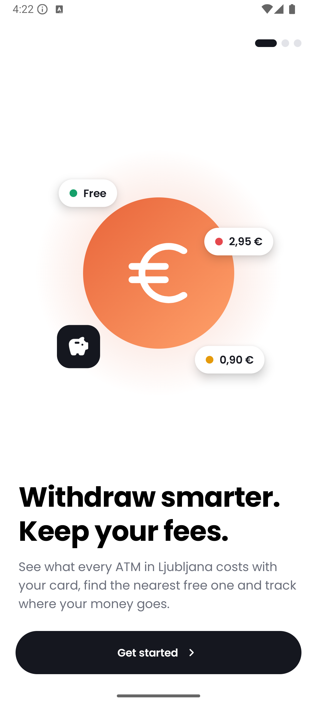
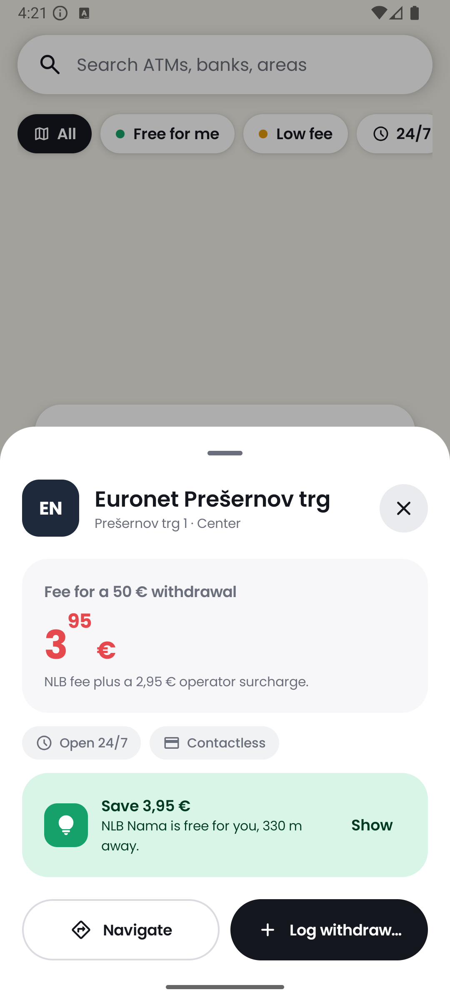
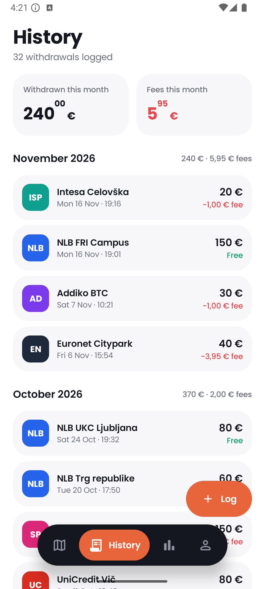
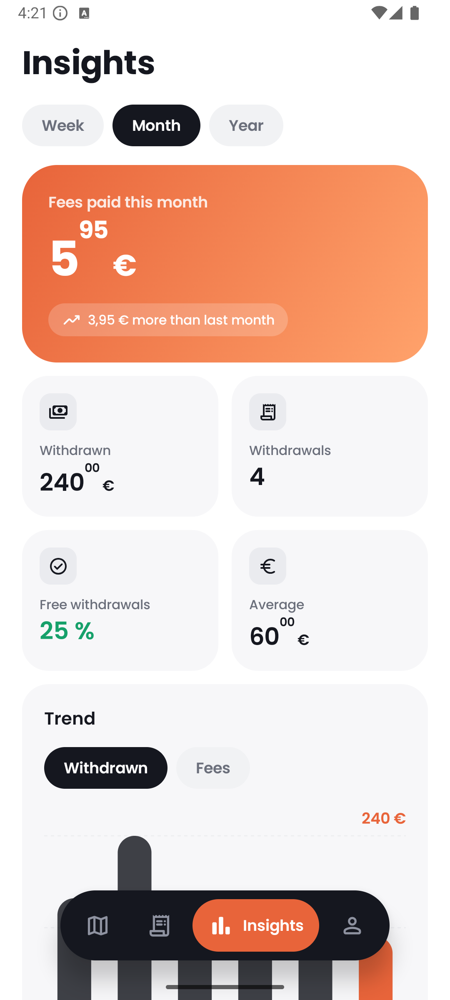
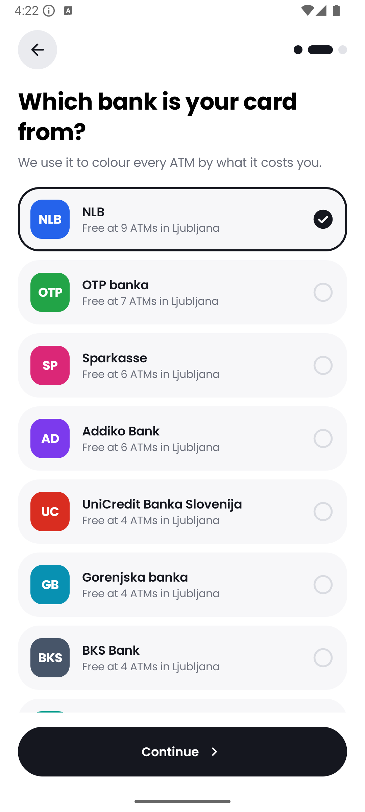
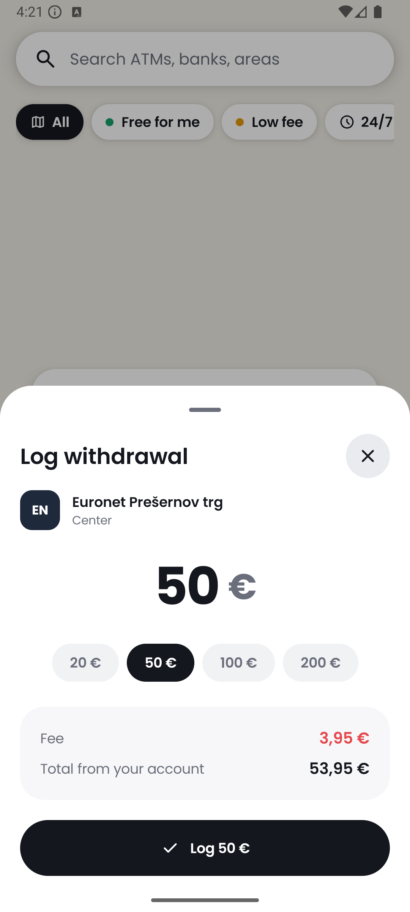
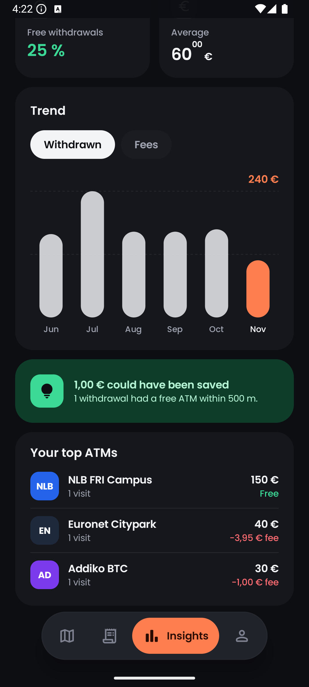
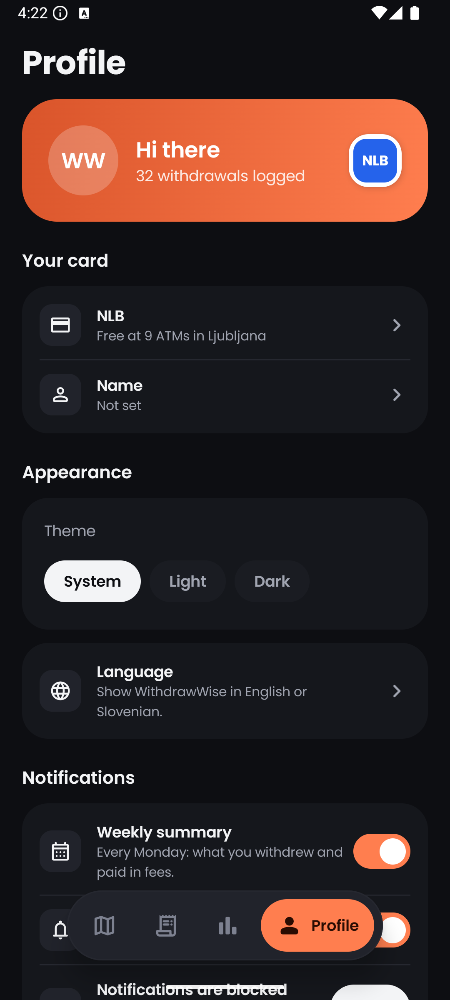
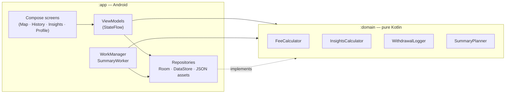

<div align="center">

# 💸 WithdrawWise

**Withdraw smarter. Keep your fees.**

See what every ATM in Ljubljana costs with *your* card, jump to the nearest free one,<br/>
log your withdrawals in two taps and find out how much you could have saved.


[](https://github.com/itslanmi/withdrawwise-android-app/actions/workflows/ci.yml)

</div>

<p align="center">
  
  
  
  
</p>
<p align="center">
  
  
  
  
</p>

---

## ✨ Features

### 🗺️ Map-first, colour-coded ATMs
- Full-screen Google Map of Ljubljana with **pins coloured by what each ATM costs you**: 🟢 free, 🟠 low fee, 🔴 expensive.
- Accent-insensitive search ("presern" finds *Prešernov trg*) and filters: *Free for me*, *Low fee*, *24/7*.
- **Nearest free** jumps straight to the closest ATM that is free with your card.
- Tap a pin for the exact fee for a 50 € withdrawal and *why* (own bank, partner network, your bank's fee, operator surcharge), plus walking directions.
- 💡 *"Save 3,95 € — NLB Nama is free for you, 330 m away."*

### 🧾 Log and history
- Log a withdrawal from the map or from History in two taps: quick amounts (20/50/100/200 €) with a **live fee preview**.
- History grouped by month with totals, swipe-to-delete with undo, and tap to edit.

### 📊 Insights
- Week / month / year views: fees paid compared with the previous period, total withdrawn, share of free withdrawals, average withdrawal.
- Animated trend chart for amounts withdrawn or fees paid.
- **Avoidable fees:** how much you paid at ATMs that had a free one within 500 m.
- Your most-used ATMs.

### 🔔 Summaries
- Weekly (Mondays) and monthly (1st) notifications with your totals. Tapping one opens Insights.

### 🎨 Polish
- Custom Material 3 design system inspired by Ljubljana's city apps: Poppins, soft cards, black pill buttons, floating nav bar.
- **Light and dark** themes designed together, with an in-app theme switch.
- 🇬🇧 English and 🇸🇮 Slovenian, with per-app language selection.
- Adaptive and themed launcher icon, splash screen, predictive back.

> **Demo data:** banks, ATM locations and fees are *illustrative* and bundled as JSON in
> [`app/src/main/assets/seed`](app/src/main/assets/seed). They do not reflect any bank's real price list.

---

## 🏗️ Architecture



- **`:domain`** is plain Kotlin/JVM with no Android dependencies: money as cents, fee rules, the fee engine, insights maths and use cases. It is fully unit tested.
- **`:app`** contains a single Activity, Navigation Compose with type-safe routes, Hilt for dependency injection, Room for withdrawals, DataStore for the profile, and WorkManager for summaries.

| Area | Tech |
|---|---|
| UI | Jetpack Compose, Material 3, custom theme, Poppins, Material Symbols Rounded |
| Maps and location | Google Maps Compose, custom JSON map styles, Fused Location Provider |
| State | ViewModel, Kotlin Coroutines and `StateFlow` |
| DI | Hilt (KSP) |
| Storage | Room, DataStore Preferences, kotlinx.serialization (seed data) |
| Background | WorkManager with Hilt workers |
| Quality | JUnit, Spotless + ktlint (with Compose rules), Android Lint, GitHub Actions |
| Build | Gradle 9, AGP 9 (built-in Kotlin), Kotlin 2.4, R8 |

---

## 🛠️ Getting started

**Requirements:** Android Studio (latest stable) or JDK 17+, and the Android SDK (platform 37).

1. Clone the repo and open it in Android Studio.
2. Get a free [Google Maps SDK for Android](https://developers.google.com/maps/documentation/android-sdk/get-api-key) key.
3. Add it to `local.properties` in the project root (this file is git-ignored):
   ```properties
   MAPS_API_KEY=AIza...
   ```
   Or export `MAPS_API_KEY` as an environment variable. Without a key the app still runs: search, filters, ATM details, history and insights all work, and the map shows a notice instead of tiles.
4. Run the `app` configuration, or build from the command line:
   ```bash
   ./gradlew assembleDebug
   ```
5. To try every screen immediately, open **History → Load sample data**.

| Task | What it does |
|---|---|
| `./gradlew test` | Unit tests (`:domain` and `:app`) |
| `./gradlew spotlessApply` | Formats Kotlin with ktlint |
| `./gradlew lintDebug` | Android lint |
| `./gradlew assembleRelease` | Minified release APK (debug-signed unless a keystore is configured) |

### CI and releases
- Every push and pull request runs formatting, unit tests, lint and a debug build ([`ci.yml`](.github/workflows/ci.yml)).
- Pushing a tag like `v1.0.0` builds a minified APK and attaches it to a GitHub Release ([`release.yml`](.github/workflows/release.yml)). Optional signing secrets are documented in the workflow.

---

## 🗺️ Roadmap
- Live ATM data from OpenStreetMap and more Slovenian cities
- Real fee tables per bank
- Home-screen widget showing this month's fees
- CSV export
- Compose UI and screenshot tests

---

## 🙌 Credits

Built by **Milan Momcilovic**. It started as a project at the Faculty of Electrical Engineering and Computer Science, University of Maribor, and was rebuilt as a modern Compose app.

- Font: [Poppins](https://fonts.google.com/specimen/Poppins) (SIL Open Font License 1.1)
- Icons: [Material Symbols Rounded](https://fonts.google.com/icons) (Apache License 2.0)
- Design inspiration: the map-first layout of Ljubljana's Urbana app
